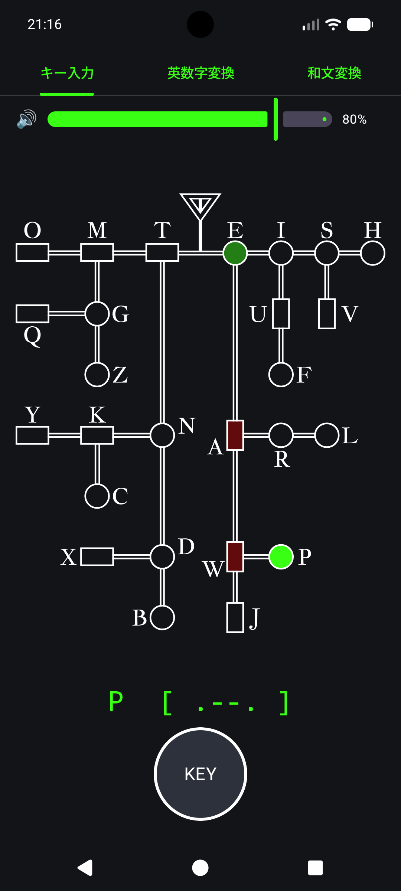
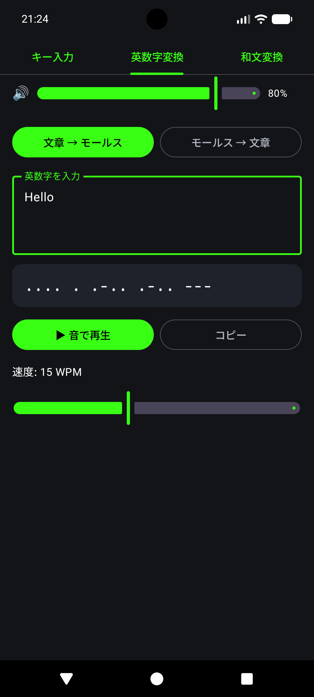
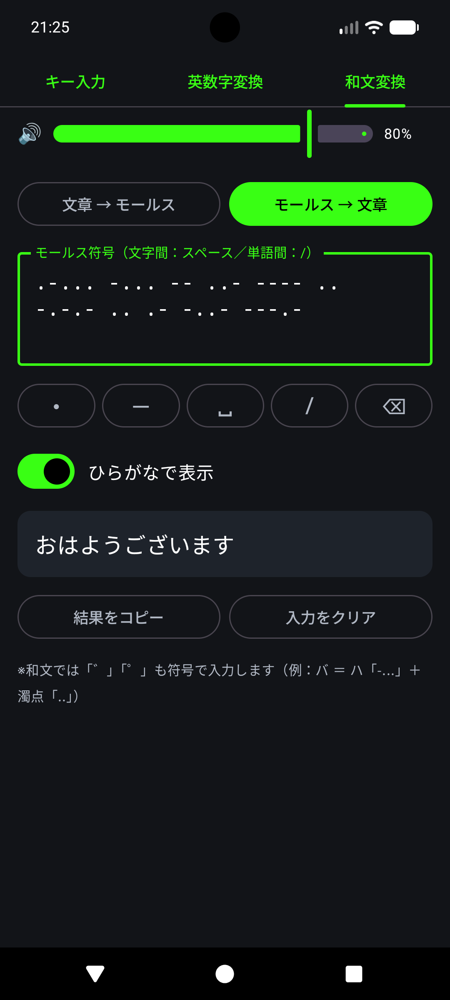

# Morse View App

モールス信号を見て・聴いて・打って学べる Android アプリです。
モールス符号の木が光る様子を見ながらキーを打てるほか、文章とモールス符号を相互に変換できます。英数字（国際モールス）と日本語（和文モールス）の両方に対応しています。


|キー入力|国際モールス|和文モールス|
|---|---|---|
||||
<br>

## 特長

- **キー入力タブ**: 画面下の KEY ボタンを押して、モールス符号を打てます。入力した経路がモールス木の上で光ります。
- **英数字変換タブ**: 英数字・記号 ⇔ 国際モールス符号
- **和文変換タブ**: ひらがな・カタカナ ⇔ 和文モールス符号
- **音で再生**: 変換した符号を 1000Hz のトーンで再生（速度 5〜30 WPM）
- **アプリ内音量調整**: 全タブ共通のスライダー。再生中でも即座に反映され、値は保存されます
- **低遅延のキー音**: 押した瞬間に音が出るよう、オーディオ周りをチューニング済み
- **ランプ風の発光**: 点灯はすばやく、消灯はゆっくり余韻を残して消えます
- **ディスプレイカットアウト対応**: 重要な表示が隠れないよう、画面端のインセットを考慮したレイアウト

<br>

## 使い方

### キー入力タブ

| 操作 | 結果 |
|---|---|
| KEY を短く押す（0.2 秒未満） | 短点 `.` |
| KEY を長く押す（0.2 秒以上） | 長点 `-` |
| 最後の入力から 1 秒放置 | 入力がリセットされ、光が消える |

- 入力は最大 4 符号までです。
- 入力した符号に対応する文字は、モールス木の下（KEY ボタンの上）に `A  [ .- ]` の形式で表示されます。
- 押している間はアンテナマークと KEY ボタンが光り、1000Hz の音が鳴ります。
- 木の上では、現在のノードが明るく、そこに至る経路が少し暗く光ります。

### 変換タブ（英数字 / 和文）

画面上部のボタンで変換方向を切り替えます。

**文章 → モールス**

1. テキストを入力します。
2. 符号が下に表示されます。文字の間は半角スペース、単語の間は ` / ` です。
3. 「▶ 音で再生」で再生、「■ 停止」で停止します。「コピー」でクリップボードに保存できます。

| 入力 | 出力 |
|---|---|
| `HELLO WORLD` | `.... . .-.. .-.. --- / .-- --- .-. .-.. -..` |
| `ありがとう`（和文） | `--.-- --. .-.. .. ..-.. ..-` |

**モールス → 文章**

1. 符号を入力します。文字の間は**スペース**、単語の間は **`/`**（またはスペース 3 つ以上、改行）で区切ります。
2. 下の入力補助ボタン（`・` `－` `␣` `/` `⌫`）でも入力できます。
3. 結果が下に表示されます。解読できない符号は `?` になります。

`・`、`－`、`ー` など、日本語入力でよく使われる記号も受け付けます。和文では「ひらがなで表示」スイッチで出力をひらがなに切り替えられます。

<br>

## 対応する文字

| タブ | 対応文字 |
|---|---|
| 英数字 | `A–Z`、`0–9`、`. , ? ' ! / ( ) & : ; = + - _ " $ @` |
| 和文 | カタカナ（ン・ヰ・ヱ を含む）、濁点 `゛`、半濁点 `゜`、長音 `ー`、`、` `。` `「` `」`、数字 `0–9` |

和文入力では、次の変換を自動で行います。

- ひらがな、半角カナ → カタカナ
- 小書き文字（`ャ` `ュ` `ョ` `ッ` `ァ` など） → 通常サイズの文字
- 濁音・半濁音 → 「清音 + 濁点／半濁点」に分解（例: `ガ` → `カ` + `゛`）
- `, . ( ) -` → `、 。 「 」 ー`

> 漢字は変換できません。ひらがな・カタカナに直して入力してください。変換できなかった文字は画面に表示されます。

<br>

## タイミング仕様

標準的な PARIS 基準に従います。1 単位 = `1.2 ÷ WPM` 秒です。

| 項目 | 長さ（単位） |
|---|---|
| 短点 `.` | 1 |
| 長点 `-` | 3 |
| 符号間の無音 | 1 |
| 文字間の無音 | 3 |
| 単語間の無音 | 7 |

<br>

## 動作環境・ビルド

- Android Studio（Kotlin / Jetpack Compose / Material 3）
- `androidx.activity` 1.8 以上（`enableEdgeToEdge()` を使用）
- 追加のサードパーティライブラリは不要です。

```bash
git clone <このリポジトリのURL>
```

Android Studio でプロジェクトを開き、実機またはエミュレータで実行してください。音の遅延を確認するには、エミュレータより実機をおすすめします。

低遅延モード（API 26 以上）とバッファの自動調整（API 24 以上）は、対応する OS でのみ有効になります。それ以前の OS では、通常のバッファ設定で動作します。

### 必要なリソース

モールス木の枠線は、ベクター画像 `res/drawable/ic_morse_frame`（元 SVG のサイズ 6696 × 7960）として読み込んでいます。光らせる位置の座標も、この SVG に合わせています。画像を差し替える場合は、`MainActivity.kt` の `morseNodes` の座標を合わせて更新してください。

<br>

## プロジェクト構成

アプリの本体は `MainActivity.kt` の 1 ファイルです。

| セクション | 内容 |
|---|---|
| `MainActivity` | edge-to-edge の設定、テーマ（ダーク） |
| `ToneGenerator1000Hz` | キー入力用のリアルタイム 1000Hz トーン生成（低遅延） |
| モールス符号テーブル | `internationalMorse`（国際）、`wabunMorse`（和文） |
| 変換ロジック | `encodeText` / `decodeMorse` / `normalizeForWabun` |
| 再生 | `renderMorsePcm`（符号を PCM 波形に展開）/ `playMorse`（再生） |
| `morseNodes` | モールス木の各ノードの文字・符号・座標・形 |
| `MorseApp` | タブと音量バーを持つルート画面 |
| `MorseKeyScreen` | キー入力タブ（木の発光、KEY ボタン） |
| `ConverterScreen` | 変換タブ（英数字・和文で共通） |

<br>

## 実装メモ

### キー入力の低遅延化

- 端末ネイティブのサンプルレートとバースト幅（`AudioManager` から取得）に合わせて `AudioTrack` を作成
- `PERFORMANCE_MODE_LOW_LATENCY` を指定（API 26 以上）
- 先行して溜めるバッファを小さく絞り、アンダーランが起きたら自動で増やす適応調整
- 音声スレッドの優先度を `THREAD_PRIORITY_URGENT_AUDIO` に設定
- タッチは `awaitEachGesture` で処理し、指が触れたイベントの中から直接発音。長短の判定にはタッチイベント自身の時刻を使用
- プツッというノイズを防ぐため、約 3ms のフェードイン・フェードアウトを入れています

### 変換タブの再生

再生中に「音を出す／止める」を切り替える方式だと、バッファの先行書き込みなどの影響で、短い無音が消えて音がつながることがあります。そのため、符号全体を無音も含めた 1 本の PCM 波形として先に作り、それを途切れなく流しています。音と音の間隔はサンプル数で決まるので、再生側の遅延の影響を受けません。

### 音量

スライダーの値を 2 乗してゲインにし、`AudioTrack.setVolume()` で適用しています。端末本体のメディア音量とは独立しています。

### 発光

アンテナと各ノードの明るさを `Animatable` で個別にアニメーションさせています。点灯は速く、消灯はゆっくり（減速カーブ）にして、ランプのような余韻を出しています。

<br>

## カスタマイズ

| 変更したいこと | 場所 |
|---|---|
| 短点／長点の境界（既定 0.2 秒） | `MorseKeyScreen` 内の `200L` |
| 入力リセットまでの時間（既定 1 秒） | `MorseKeyScreen` 内の `delay(1000L)` |
| 点灯・消灯の速さ | `LAMP_RISE_MS` / `LAMP_FALL_MS` |
| トーンの周波数（既定 1000Hz） | `ToneGenerator1000Hz` の `frequency`、`renderMorsePcm` 内の `1000.0` |
| 初期音量（既定 80%） | `MorseApp` 内の `getFloat("volume", 0.8f)` |
| 再生速度の範囲（既定 5〜30 WPM） | `ConverterScreen` の `Slider` の `valueRange` |

<br>

## 既知の制限

- 漢字は変換できません。
- 和文の濁点 `゛` の符号 `..` は、英字の `I` と同じです。解読は和文タブで行ってください。
- 和文タブでは、アルファベットの混在（欧文モールスへの切り替え符号）には対応していません。
- Bluetooth イヤホンを使うと、端末側の遅延が加わって、キー入力の反応が遅く感じられます。
- キー入力タブは符号を文字として表示するだけで、文章としては記録しません。

<br>

## ライセンス
CC BY-NC-SA 4.0
